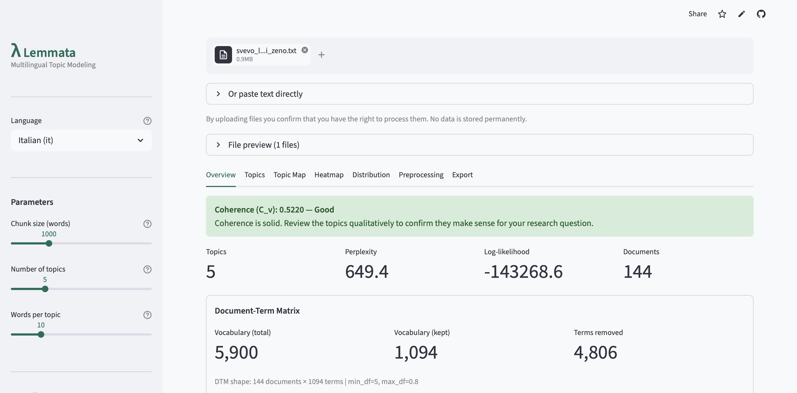

# Lemmata

    [](https://doi.org/10.5281/zenodo.19391730)

## Screenshot

<p align="center">
  
</p>

<p align="center"><em>Analysis of Italo Svevo's <i>La coscienza di Zeno</i> — 5 topics, C_v coherence 0.5220</em></p>

**A multilingual LDA topic modeling platform for humanities researchers.**

---

## What is Lemmata?

Lemmata is a browser-based tool that lets humanities researchers perform LDA (Latent Dirichlet Allocation) topic modeling on literary and historical texts — without writing a single line of code.

Upload your texts, choose your language, adjust parameters, and download reproducible results. You use it in a web browser with nothing to install; the analysis itself runs on the server that hosts the app (lda.lemmata.app, or your own computer if you run it locally).

**Supported languages:** Italian, English, German, French, Spanish

---

## Quick start

No installation required. Open the platform in your browser:

**[lemmata.app](https://lemmata.app)**

1. Select your language and POS filter in the sidebar.
2. Upload one or more files (.txt, .pdf, .odt, .docx, .epub) or paste text directly.
3. Click **Run Analysis**.
4. Explore the results across seven tabs (Overview, Topics, Topic Map, Heatmap, Distribution, Preprocessing, Export).
5. Download all outputs as a ZIP file or generate a PDF report.

---

## Features

| Feature | Description |
|---|---|
| **Multilingual NLP** | Five languages with dedicated spaCy pipelines and language-specific stopwords |
| **POS filtering** | Presets (content words, content + verbs, all open classes) or custom selection |
| **Custom stopwords** | Add domain-specific stopwords on top of the built-in lists |
| **Vocabulary pruning** | Removes words in fewer than 0.5% or more than 99% of the documents (the standard reported by Maier et al. 2020), shows what was removed, and lets you change both thresholds |
| **Coherence scoring** | C_v coherence (Röder et al. 2015) with an explanation of what it measures; no quality bands, since the measure has no accepted cut-offs |
| **Interactive charts** | Altair-based interactive visualizations with hover details |
| **Topic Map** | pyLDAvis visualization with graceful fallback |
| **Preprocessing trace** | Token-level table showing every step (original, lemma, kept/removed, reason) |
| **Deterministic results** | A fixed seed (default 42) gives identical results on repeated runs with either inference method |
| **Topic stability check** | Refits the model with 10 seeds and shows how often each topic recurs (measure of Agrawal, Fu and Menzies 2018) |
| **PDF report** | Auto-generated analysis report suitable for course assignments or publications |
| **ZIP export** | All outputs (CSV, JSON, PNG, SVG, environment report) in one download |

---

## Local installation

### 1. Clone the repository

```bash
git clone https://github.com/oguzkoran-max/lemmata.git
cd lemmata
```

### 2. Create a virtual environment (recommended)

```bash
python -m venv .venv
source .venv/bin/activate   # Linux/macOS
.venv\Scripts\activate      # Windows
```

### 3. Install dependencies

```bash
pip install -r requirements.txt
```

### 4. Download spaCy language models

```bash
python -m spacy download it_core_news_sm
python -m spacy download en_core_web_sm
python -m spacy download de_core_news_sm
python -m spacy download fr_core_news_sm
python -m spacy download es_core_news_sm
```

### 5. Run the application

```bash
streamlit run src/lemmata/app.py
```

The application opens at `http://localhost:8501`.

---

## Architecture

Lemmata follows a modular design with strict separation of concerns. The UI layer (`app.py`) contains no business logic.

```
lemmata/
├── app.py              # Streamlit UI only
├── config.py           # Constants, language configs, slider ranges
├── preprocessing.py    # spaCy NLP pipeline, POS filtering, lemmatization, trace
├── modelling.py        # LDA (tomotopy Gibbs, scikit-learn variational), coherence (Gensim)
├── visualisation.py    # Charts, wordclouds, pyLDAvis (zero st.* calls)
├── file_io.py          # File readers, ZIP/PDF export, environment report
├── requirements.txt    # Pinned dependencies
├── ARCHITECTURE.md     # 200 design decisions
├── prompts/            # Development prompt logs
└── tests/              # Pytest test suite
```

**Design decisions:**
- Two inference methods: Gibbs sampling (tomotopy), the default since v0.3.0, with MALLET's default settings; variational Bayes (scikit-learn), the only method before v0.3.0, kept to reproduce earlier results.
- Gensim CoherenceModel used independently for C_v evaluation.
- The use of spaCy and the default part-of-speech filter (NOUN, PROPN, ADJ) follow the advice of a corpus linguist (Doç. Dr. Hakan Cangır), given before development. The choice of small (sm) spaCy models was proposed by the language model during planning.

---

## Reproducibility

- **Fixed random state:** seed 42 by default, editable in Advanced settings. Gibbs sampling runs on one worker so that the seed fixes the result.
- **Batch learning (variational method):** learning_method='batch' eliminates document-order effects.
- **Environment report:** Every analysis exports Python version, package versions, and all parameters.
- **Same data, parameters, seed and package versions give the same result;** the test suite checks this.

---

## How it was built

Lemmata was developed by a researcher without programming expertise. Decisions were planned in a conversation with Claude (Opus 4.6) and the code was written by [Claude Code](https://docs.anthropic.com/en/docs/claude-code) (Anthropic) from prompts drafted there (27 March – 3 April 2026).

What is documented, and its limits:

1. **Prompt log.** The prompts sent to Claude Code and summaries of their results are in the [`prompts/`](prompts/) directory. Full responses are not included.

2. **Expert input.** A corpus linguist advised on spaCy and the default part-of-speech filter before development. Most other technical decisions were proposed by the language model and accepted by the developer.

3. **Automated testing.** The test suite (185 tests in v0.3.0) checks determinism and module behaviour. It did not catch two errors found later by a validation study, both fixed in v0.3.0 (see [CHANGELOG](CHANGELOG.md)).

An article on the development process is in preparation.

---

## Citation

```bibtex
@software{koran_lemmata_2026,
  author       = {Koran, Oğuz and Yücesan, Barış and Cangır, Hakan},
  title        = {Lemmata: A Multilingual LDA Topic Modeling Platform for Digital Humanities},
  year         = {2026},
  url          = {https://lemmata.app}
}
```

Click **"Cite this repository"** on the GitHub page for auto-generated citation via [`CITATION.cff`](CITATION.cff).

---

## Contributing

Contributions are welcome. See [`CONTRIBUTING.md`](CONTRIBUTING.md).

---

## License

MIT License. See [`LICENSE`](LICENSE).

---

## Acknowledgments

Lemmata is developed at [Ankara University](https://www.ankara.edu.tr/), School of Foreign Languages (Italian Language and Literature) and Faculty of Languages, History and Geography — DTCF (Italian Language and Literature).

The entire codebase was generated through LLM-assisted development using [Claude](https://claude.ai/) and [Claude Code](https://docs.anthropic.com/en/docs/claude-code) by [Anthropic](https://www.anthropic.com/). Built with [spaCy](https://spacy.io/), [tomotopy](https://bab2min.github.io/tomotopy/), [scikit-learn](https://scikit-learn.org/), [Gensim](https://radimrehurek.com/gensim/), [Altair](https://altair-viz.github.io/), and [Streamlit](https://streamlit.io/).
